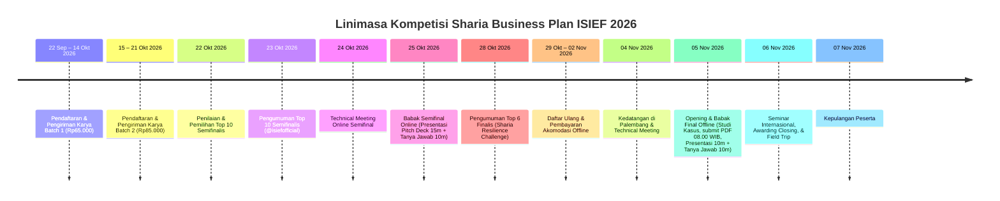

# DOKUMEN STRATEGIS & BEDAH BOOKLET LOMBA ISIEF 2026
## Sharia Business Plan Competition — International Symposium on Islamic Economic Finance
**Penyelenggara:** UIN Raden Fatah Palembang x FoSSEI x KSEI PAKIES  
**Produk / Platform:** **ZIFORA (*ZISWAF for a Better Era*)**  
**Slogan:** *“Terintegrasi, Transparan, dan Terpercaya.”*  
**Sub-Tema:** **Inovasi ZISWAF** *(Cross-cutting: Digital Philanthropy, Green Economy, dan Tokenisasi Aset Produktif)*

---

## 1. Ringkasan Eksekutif & Identitas Lomba

| Parameter | Ketentuan Booklet ISIEF 2026 |
| :--- | :--- |
| **Nama Lomba** | Sharia Business Plan (SBP) ISIEF 2026 |
| **Tema Utama** | *"Navigating Global Economic Resilience: Integrating Islamic Capital Markets, Digital Philanthropy, and Sustainable Ecosystems"* |
| **Sub-Tema Relevan** | **Inovasi ZISWAF** *(Integrasi Filantropi Digital dan Keberlanjutan)* |
| **Bentuk Tim** | 3 Mahasiswa per tim (Aktif S1/D4, Semester 1–6; Semester 7–8 dilarang) |
| **Format Karya Awal** | **Business Model Canvas (BMC)** + **Proposal Sharia Business Plan (15–25 Halaman)** |
| **Output Prototipe** | Diperbolehkan dan sangat dianjurkan membawa prototipe/media pendukung nyata saat Final |

---

## 2. Linimasa Kritis & Deadline Penting (Roadmap 2026)



---

## 3. Matriks Kriteria Penilaian (Rubrik Juri) & Respon ZIFORA

### A. Babak Penyisihan (Proposal 15–25 Hlm + BMC)
| Aspek Penilaian | Bobot | Keunggulan Strategis ZIFORA |
| :--- | :---: | :--- |
| **Kelayakan & Keterpaduan Model Bisnis** | **20%** | BMC 9-blok ZIFORA terintegrasi: Ekosistem 5 Pilar (Zakat, Wakaf Produktif, Infak, Sedekah Subuh, Mustahik GIS) dengan model monetisasi berkelanjutan melalui ujrah amil & nazhir resmi. |
| **Ketajaman Masalah, Solusi, & Inovasi** | **20%** | Mengatasi rendahnya realisasi potensi zakat nasional (potensi Rp327 T, realisasi baru ~Rp30 T) akibat *lack of trust* & manual audit, dipecahkan dengan **Transparent Digital Ledger** dan **Peta GIS Sebaran 8 Asnaf**. |
| **Kelayakan Bisnis & Potensi Pasar** | **20%** | TAM: Populasi muslim Indonesia 240+ juta jiwa; SAM: 85 juta pengguna aktif perbankan digital/e-wallet; SOM: Komunitas donatur milenial & muzaki korporat. |
| **Kepatuhan Syariah & Penerapan Keuangan Islam** | **15%** | Akad jelas: *Wakaf Uang* (UU No. 41/2004), *Akad Hibah/Tabarru'* (Infak/Sedekah), *Hak Amil 12.5%* (Fatwa DSN-MUI No. 08/2000), *Hak Nazhir Wakaf 10%* dari hasil pengelolaan. |
| **Ketahanan & Keberlanjutan Bisnis** | **15%** | Sumber pendapatan multi-channel (platform fee edukasi/API SaaS nazhir, bagi hasil pengelolaan aset wakaf produktif, sponsorship program CSR). |
| **Inovasi Digital & Potensi Pengembangan** | **10%** | Web App mutakhir berbasis React 19 + TypeScript + Leaflet GIS + Payment Gateway QRIS DANA Bisnis dengan kode verifikasi unik presisi (< Rp500) dan laporan real-time. |

---

### B. Babak Semifinal (Pitch Deck Online — 15 Mnt Presentasi + 10 Mnt Q&A)
| Konten Penilaian | Bobot | Target Tim ZIFORA |
| :--- | :---: | :--- |
| **Penguasaan Materi** | **25%** | Penguasaan seluruh angka finansial (BEP, NPV, IRR), teknis arsitektur, dan alur operasional. |
| **Pemahaman Bisnis & Aspek Syariah** | **25%** | Mampu menjawab secara presisi landasan fiqih muamalah kontemporer (Fiqih Zakat Yusuf Al-Qaradawi, regulasi BAZNAS & BWI). |
| **Penyampaian & Komunikasi** | **20%** | Storytelling kuat, transisi slide mulus, artikulasi meyakinkan. |
| **Kemampuan Menjawab Pertanyaan** | **20%** | Jawaban sistematis berbasis data, studi kasus empiris, dan pembuktian langsung prototipe web ZIFORA. |
| **Ketepatan Waktu** | **10%** | Presentasi tepat 14–15 menit, tidak melebihi batas waktu. |

---

### C. Babak Final Offline (*Sharia Resilience Challenge* — 10 Mnt Presentasi + 10 Mnt Q&A)
- **Tantangan Khusus:** Studi kasus acak diambil H-1 di Palembang.
- **Strategi Menang:**
  1. Menghubungkan studi kasus ketahanan ekonomi dengan fitur ZIFORA (misal: bagaimana mengatasi inflasi, krisis pangan lokal melalui Wakaf Produktif Pertanian terintegrasi peta GIS).
  2. **Demonstrasi Langsung Web App ZIFORA yang Berjalan (*Live Working Web Prototype*)**: Sementara tim lain hanya mengandalkan PDF/PPT, tim kita mendemonstrasikan aplikasi fungsional yang sudah live dan teruji.

---

## 4. Sistematika Penulisan Proposal (15–25 Halaman) Sesuai Standar ISIEF

Proposal wajib memuat 14 bab pokok:
```
Cover (Sesuai Lampiran 1 Booklet)
Kata Pengantar
Daftar Isi
BAB I. GAMBARAN UNIT BISNIS
   1.1 Latar Belakang (Gap Potensi vs Realisasi ZISWAF, Tantangan Transparansi)
   1.2 Visi dan Misi ZIFORA
   1.3 Identifikasi Permasalahan (Data Gap, Fraud Risk, Asimetri Informasi Mustahik)
   1.4 Deskripsi Bisnis ZIFORA
BAB II. MODEL BISNIS DAN STRATEGI PASAR
   2.1 Business Model Canvas (BMC) ZIFORA
   2.2 Analisis Pasar (TAM, SAM, SOM, Tren Fintech Syariah Indonesia)
   2.3 Target Pasar (Muzaki Muda, Donatur Rutin, Korporat CSR, Mitra Nazhir)
   2.4 Strategi Pemasaran (Growth Hacking, Kampanye Sedekah Subuh, Program Kemitraan Kampus/Masjid)
BAB III. KEUANGAN ISLAM DAN KEPATUHAN SYARIAH
   3.1 Sumber Permodalan (Bootstrapping, Hibah Kompetisi, Angel Investor Syariah)
   3.2 Akad yang Digunakan (Akad Wakaf Uang, Akad Wakalah bil Ujrah, Tabarru')
   3.3 Biaya Operasional (Server, Pemeliharaan GIS, Verifikasi Lapangan Mustahik)
   3.4 Mekanisme Transaksi (QRIS Dinamis, Unique Code < Rp500, Sensor Webhook Otomatis)
   3.5 Kepatuhan terhadap Prinsip Syariah (Rujukan DSN-MUI, Regulasi BAZNAS & BWI)
BAB IV. STRATEGI DIGITAL DAN INOVASI
   4.1 Arsitektur Platform Web Terintegrasi
   4.2 Geographic Information System (GIS) Sebaran 8 Asnaf & Aset Wakaf
   4.3 Sistem Verifikasi Pembayaran Real-time
   4.4 Cloudinary Media Hub & Digital Certificate Engine
BAB V. KEBERLANJUTAN DAN DAMPAK
   5.1 Dampak Ekonomi (Peningkatan Daya Beli Mustahik, Efisiensi Pengelolaan Aset Wakaf)
   5.2 Dampak Sosial (Eradikasi Kemiskinan Ekstrem, Pemberdayaan Pendidikan Santri)
   5.3 Dampak Lingkungan (Wakaf Sumur Tenaga Surya, Klinik Sehat Ramah Lingkungan)
BAB VI. STRATEGI KETAHANAN EKONOMI
   6.1 Risiko dan Tantangan (Volatilitas Donasi, Keamanan Siber, Regulasi)
   6.2 Strategi Adaptasi (Diversifikasi Program, Cadangan Dana Likuiditas Syariah)
   6.3 Strategi Keberlanjutan Bisnis (Sustainability Roadmap)
   6.4 Potensi Pengembangan dan Skalabilitas (Integrasi Sukuk Wakaf / CWLS, Ekspresi Regional)
BAB VII. KELAYAKAN FINANSIAL
   7.1 Permodalan Awal
   7.2 Biaya Operasional (Fixed & Variable Cost)
   7.3 Proyeksi Pendapatan (Tahun 1 – Tahun 5)
   7.4 Break Even Point (BEP)
   7.5 Net Present Value (NPV)
   7.6 Internal Rate of Return (IRR)
   7.7 Payback Period
BAB VIII. PETA JALAN IMPLEMENTASI (ROADMAP 2026–2030)
BAB IX. PENUTUP
DAFTAR PUSTAKA
LAMPIRAN (Formulir Pendaftaran, CV 3 Anggota Tim, Lembar Pernyataan Orisinalitas Bermaterai Rp10.000)
```

---

## 5. Komparasi Fitur Web ZIFORA vs Kebutuhan Presentasi & Proposal

| Komponen Proposal ISIEF | Implementasi di Web App ZIFORA | Lokasi File di Codebase |
| :--- | :--- | :--- |
| **Kalkulator Zakat 5 Kategori** | Kalkulator zakat profesi, emas, tabungan, perdagangan, dan fitrah dengan threshold nisab otomatis | `src/pages/ZakatPage.tsx` |
| **Manajemen Wakaf Produktif** | Tracking yield aset wakaf (Klinik, Lahan, Sumur Tenaga Surya) | `src/pages/WakafPage.tsx` |
| **Filantropi Cepat (Sedekah Subuh)** | Quick-donation widget 1-klik untuk infak rutin harian | `src/pages/InfakSedekahPage.tsx` |
| **Pemetaan Geografis 8 Asnaf (GIS)** | Peta interaktif Leaflet dengan filter Zakat, Wakaf, Infak, dan Mustahik | `src/pages/PetaZiswafPage.tsx` |
| **Transparansi & Audit Finansial** | Laporan arus kas, invoice tracker digital `ZFR-...`, audit terpadu | `src/pages/TransparansiPage.tsx` |
| **Gerbang Pembayaran QRIS Real-time** | QRIS DANA Bisnis + sensor kode verifikasi unik (< Rp500) + e-sertifikat | `src/pages/CheckoutPage.tsx` |
| **Portal Ganda Enterprise** | Single login portal (`/login` & `/portal`) untuk Super Admin & Muzaki | `src/pages/PortalPage.tsx` & `LoginPage.tsx` |

---

## 6. Target & Standar Kejuaraan
- **Target:** **Juara I (Trophy + Sertifikat + Uang Pembinaan)**.
- **Kunci Pembeda:** Menjadi satu-satunya tim yang tidak hanya datang membawa ide proposal di atas kertas, melainkan membawa **Platform Fintech ZISWAF yang sudah berfungsi penuh, responsif di HP/desktop, terintegrasi peta GIS, dan siap diimplementasikan secara riil**.
