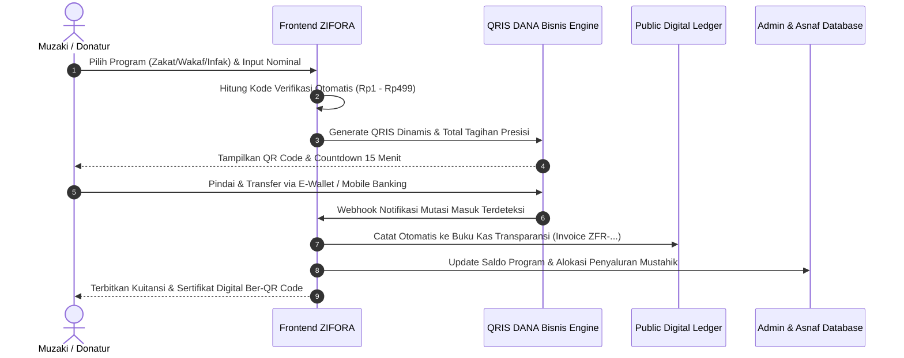
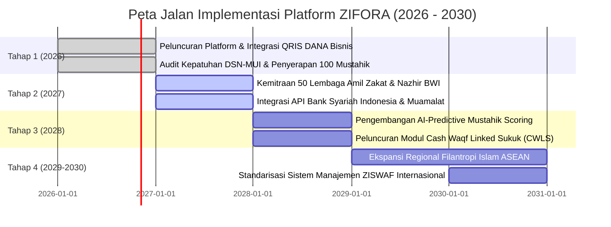

# PROPOSAL SHARIA BUSINESS PLAN
## INTERNATIONAL SYMPOSIUM ON ISLAMIC ECONOMIC FINANCE (ISIEF) 2026
**Sub-Tema:** Inovasi ZISWAF *(Digital Philanthropy & Sustainable Ecosystems)*  
**Nama Platform / Unit Bisnis:** **ZIFORA (*ZISWAF for a Better Era*)**  
**Slogan:** *“Terintegrasi, Transparan, dan Terpercaya.”*

---

# DAFTAR ISI

- **BAB I. GAMBARAN UNIT BISNIS**
  - 1.1 Latar Belakang
  - 1.2 Visi dan Misi
  - 1.3 Identifikasi Permasalahan
  - 1.4 Deskripsi Bisnis ZIFORA
- **BAB II. MODEL BISNIS DAN STRATEGI PASAR**
  - 2.1 Business Model Canvas (BMC) Terperinci
  - 2.2 Analisis Pasar (TAM, SAM, SOM)
  - 2.3 Target Pasar
  - 2.4 Strategi Pemasaran & Akuisisi Pengguna
- **BAB III. KEUANGAN ISLAM DAN KEPATUHAN SYARIAH**
  - 3.1 Sumber Permodalan
  - 3.2 Akad Syariah yang Digunakan
  - 3.3 Struktur Biaya Operasional & Hak Pengelola
  - 3.4 Mekanisme Transaksi End-to-End
  - 3.5 Kepatuhan terhadap Prinsip Syariah & Regulasi
- **BAB IV. STRATEGI DIGITAL DAN INOVASI**
  - 4.1 Arsitektur Sistem Terintegrasi Multi-Tier
  - 4.2 Sistem Informasi Geografis (GIS) Spasial 8 Asnaf & Aset Wakaf
  - 4.3 Mesin Rekonsiliasi Pembayaran QRIS Dinamis Real-Time
  - 4.4 Buku Besar Audit Publik Terbuka (*Transparent Public Ledger*)
- **BAB V. KEBERLANJUTAN DAN DAMPAK**
  - 5.1 Dampak Ekonomi
  - 5.2 Dampak Sosial
  - 5.3 Dampak Lingkungan (*Green Waqf Ecosystem*)
- **BAB VI. STRATEGI KETAHANAN EKONOMI (*SHARIA RESILIENCE*)**
  - 6.1 Identifikasi Risiko dan Tantangan
  - 6.2 Strategi Adaptasi Terhadap Dinamika Ekonomi Global
  - 6.3 Strategi Keberlanjutan Bisnis Jangka Panjang
  - 6.4 Potensi Pengembangan dan Skalabilitas
- **BAB VII. KELAYAKAN FINANSIAL**
  - 7.1 Proyeksi Permodalan Awal (Capex & Opex)
  - 7.2 Rincian Biaya Operasional Berjalan
  - 7.3 Proyeksi Finansial 5 Tahun (2026–2030)
  - 7.4 Analisis Break Even Point (BEP)
  - 7.5 Analisis Net Present Value (NPV)
  - 7.6 Analisis Internal Rate of Return (IRR)
  - 7.7 Analisis Payback Period (PBP)
- **BAB VIII. PETA JALAN IMPLEMENTASI (*ROADMAP 2026–2030*)**
- **BAB IX. PENUTUP**
- **DAFTAR PUSTAKA**

---

# BAB I. GAMBARAN UNIT BISNIS

### 1.1 Latar Belakang
Indonesia merupakan negara dengan populasi muslim terbesar di dunia, mencakup lebih dari 240 juta jiwa atau sekitar 86,7% dari total penduduk nasional (Badan Pusat Statistik, 2024). Posisi demografis ini menempatkan Indonesia sebagai episentrum kekuatan filantropi Islam global, sebagaimana dibuktikan oleh *World Giving Index* (Charities Aid Foundation, 2023) yang menobatkan Indonesia sebagai negara paling dermawan di dunia selama enam tahun berturut-turut.

Secara makroekonomi syariah, instrumen Zakat, Infak, Sedekah, dan Wakaf (ZISWAF) memegang peranan krusial sebagai jaring pengaman sosial (*social safety net*) dan mesin pemerataan distribusi kekayaan (*wealth distribution*). Berdasarkan laporan Indikator Pemetaan Potensi Zakat (IPPZ) yang dirilis oleh Badan Amil Zakat Nasional (BAZNAS, 2023), potensi zakat nasional di Indonesia mencapai **Rp327,6 triliun per tahun**, yang mencakup zakat penghasilan, zakat perorangan, zakat perusahaan, dan zakat tabungan. Di sisi lain, Badan Wakaf Indonesia (BWI, 2023) mencatat potensi wakaf uang nasional menembus angka **Rp180 triliun per tahun**, didukung oleh lebih dari 440.000 titik aset wakaf tanah yang tersebar di seluruh pelosok Nusantara.

Namun demikian, terdapat paradoks fundamental yang menghambat realisasi potensi tersebut:
1. **Disparitas Realisasi Finansial yang Masif:** Hingga akhir tahun 2023, penghimpunan zakat nasional baru terealisasi sekitar **Rp32 triliun** (kurang dari 10% dari total potensi). Sementara itu, wakaf uang yang berhasil diakumulasikan secara nasional baru menyentuh kisaran **Rp2,3 triliun** (sekitar 1,2% dari total potensi).
2. **Krisis Kepercayaan Publik (*Trust Deficit*):** Fenomena penyelewengan dana sosial, manipulasi laporan penyaluran, serta ketertutupan arus kas di sejumlah lembaga filantropi konvensional memicu keraguan mendalam di kalangan muzaki dan donatur modern.
3. **Asimetri Informasi dan Inefisiensi Distribusi 8 Asnaf:** Penyaluran zakat sering kali terpusat di wilayah urban dan berbasis kedekatan geografis, sementara kantong-kantong kemiskinan ekstrem di wilayah terluar, tertinggal, dan terdepan (3T) mengalami *under-funding*. Data penerima manfaat (mustahik) belum terkonsolidasi secara geospasial sehingga memicu tumpang-tindih (*overlapping*) penyaluran.
4. **Stagnasi Aset Wakaf Produktif:** Mayoritas aset wakaf tanah di Indonesia (~72%) masih berstatus aset non-produktif (makam, masjid, madrasah tanpa cashflow pendukung) yang membebani masyarakat, bukan menjadi aset produktif yang mampu menghasilkan surplus ekonomi (*yield*) bagi kemaslahatan umat.

Menghadapi dinamika perekonomian global yang diwarnai disrupsi rantai pasok, volatilitas inflasi, dan kerentanan daya beli masyarakat miskin, diperlukan sebuah terobosan institusional dan teknologi. **ZIFORA (*ZISWAF for a Better Era*)** hadir sebagai platform sistem informasi manajemen ZISWAF terintegrasi pertama di Indonesia yang memadukan **pemetaan geospasial interaktif (GIS)**, **buku besar audit real-time (*transparent digital ledger*)**, **gerbang pembayaran QRIS dinamis otomatis**, serta **tata kelola profesional multi-portal (Admin & Muzaki)**.

### 1.2 Visi dan Misi ZIFORA

#### Visi:
Menjadi pionir platform teknologi finansial sosial Islam terdepan di Asia Tenggara yang mentransformasi ekosistem ZISWAF menjadi lebih terintegrasi, transparan, akuntabel, dan berdaya tahan tinggi guna mewujudkan keadilan sosio-ekonomi umat yang berkelanjutan.

#### Misi:
1. **Digitalisasi Terintegrasi:** Menghubungkan ekosistem muzaki, donatur, mustahik (8 asnaf), nazhir, dan regulator ke dalam satu infrastruktur digital terpadu.
2. **Transparansi Radikal:** Menghadirkan sistem pelaporan keuangan real-time berbasis buku besar publik yang dapat diakses dan diaudit oleh masyarakat kapan saja tanpa rekayasa.
3. **Optimalisasi Penyaluran Berbasis Geospasial:** Mengimplementasikan Sistem Informasi Geografis (GIS) untuk memetakan sebaran mustahik secara akurat guna mengeliminasi tumpang-tindih bantuan.
4. **Revitalisasi Aset Wakaf Produktif:** Mendorong transformasi aset wakaf pasif menjadi aset produktif bernilai ekonomi tinggi yang menghasilkan surplus manfaat sosial secara berkelanjutan.
5. **Kepatuhan Syariah Total:** Menjalankan seluruh proses bisnis dan mekanisme transaksi secara murni berlandaskan fatwa Dewan Syariah Nasional (DSN-MUI) dan regulasi perundang-undangan Republik Indonesia.

### 1.3 Identifikasi Permasalahan (Root Cause Analysis)

Melalui metode pendekatan *Fishbone Diagram* dan wawancara komparatif terhadap ekosistem lembaga filantropi, diidentifikasi empat akar permasalahan utama:
- **Aspek Sistem Pelaporan:** Pelaporan keuangan lembaga amil zakat umumnya bersifat statis, periodik (tahunan/semesteran), dan berbentuk dokumen PDF tebal yang sulit diverifikasi keabsahan transaksinya oleh publik.
- **Aspek Aksesibilitas Pembayaran:** Mekanisme pembayaran digital konvensional sering membebani muzaki dengan biaya admin terselubung atau mewajibkan upload bukti transfer manual yang memperlambat penerbitan bukti setor resmi.
- **Aspek Pengawasan Aset Wakaf:** Tidak adanya dashboard visualisasi perkembangan fisik dan finansial aset wakaf produktif (seperti rumah sakit dhuafa, sumur air bersih, lahan pertanian produktif), sehingga wakif kehilangan keterikatan (*engagement*) terhadap dampak wakaf yang disalurkan.
- **Aspek Validasi Mustahik:** Ketiadaan validasi kriteria 8 asnaf berbasis standar nisab dan status kemiskinan faktual di lapangan, mengakibatkan alokasi dana zakat rawan salah sasaran.

### 1.4 Deskripsi Bisnis ZIFORA
ZIFORA beroperasi sebagai **Platform Layanan Finansial Sosial Syariah (Fintech Filantropi Terpadu)**. Platform ini bukan sekadar portal penggalangan dana (*crowdfunding*), melainkan sebuah **Sistem Operasi Manajemen ZISWAF Lengkap** yang menyediakan modul fungsional:
1. **Modul Smart Zakat:** Kalkulator multi-kategori (Profesi, Emas, Tabungan, Perdagangan, Fitrah) yang secara otomatis menghitung nisab harian berdasarkan harga emas terkini serta memfasilitasi pelafalan akad niat digital.
2. **Modul Wakaf Produktif Berkelanjutan:** Katalog proyek wakaf infrastruktur dan modal kerja produktif (misal: Sumur Tenaga Surya, Klinik Bersalin Dhuafa, Lahan Tani Terpadu) yang dilengkapi indikator valuasi fisik, target pendanaan, dan estimasi bagi hasil sosial (*social yield*).
3. **Modul Sedekah Subuh & Bantuan Darurat:** Fitur donasi mikro 1-klik untuk membangun kebiasaan bersedekah rutin dengan batas donasi terjangkau.
4. **Peta Interaktif GIS ZISWAF:** Visualisasi geospasial berbasis data spasial interaktif yang menampilkan klaster lokasi sebaran penerima manfaat (8 Asnaf) dan titik persebaran aset wakaf fisik beserta dokumentasi progress lapangan.
5. **Transparency Explorer & Digital Ledger:** Modul transparansi terbuka di mana publik dapat melacak mutasi dana, pencairan bantuan, persentase hak amil, dan memverifikasi keabsahan kuitansi melalui nomor referensi transaksi unik (`ZFR-YYYYMMDD-XXXX`).
6. **Enterprise Dual-Portal Architecture:** Portal khusus bagi Muzaki untuk memantau portofolio kebaikan dan mengunduh Sertifikat Bukti Setor Zakat Resmi, serta Dashboard Pengelola (Super Admin) untuk memverifikasi program, persetujuan transaksi, pendataan mustahik, dan integrasi media Cloudinary CDN.

---

# BAB II. MODEL BISNIS DAN STRATEGI PASAR

### 2.1 Business Model Canvas (BMC) ZIFORA

```
+---------------------------------------------------------------------------------------------------------------------------------------+
|                                                      BUSINESS MODEL CANVAS ZIFORA                                                     |
+-----------------------------------+-----------------------------------+-----------------------------------+---------------------------+
| 1. KEY PARTNERS                   | 2. KEY ACTIVITIES                 | 3. VALUE PROPOSITIONS             | 4. CUSTOMER RELATIONSHIPS |
| • BAZNAS & Lembaga Amil Zakat     | • Verifikasi & kurasi program     | • Sistem Transparansi Real-Time   | • Layanan Notifikasi WA   |
|   (LAZ) resmi berizin             |   mustahik 8 asnaf                |   (Public Digital Ledger)         |   & Email Otomatis        |
| • Badan Wakaf Indonesia (BWI) &   | • Manajemen pemeliharaan sistem   | • Peta Interaktif Sebaran GIS     | • E-Sertifikat & Bukti    |
|   Nazhir bersertifikasi           |   GIS dan Cloudinary asset hub    |   Mustahik & Aset Wakaf           |   Setor Pajak Digital     |
| • Asosiasi Fintech Syariah (AFSI) | • Otomasi rekonsiliasi payment    | • QRIS Dinamis Instan tanpa       | • Dashboard Portofolio    |
| • Penyedia Payment Gateway &      |   gateway QRIS DANA Bisnis        |   biaya admin membingungkan       |   Kebaikan Pribadi        |
|   Perbankan Syariah (BSI, Muamalat)| • Audit syariah & pelaporan kas   | • Kalkulator 5 Kategori Zakat     | • Customer Support 24/7   |
| • Dewan Syariah Nasional (DSN-MUI)| • Edukasi & kampanye digital      |   dengan nisab otomatis harian    |                           |
| • Ormas Islam (NU, Muhammadiyah)  |                                   | • Jaminan Kepatuhan Fiqih DSN-MUI |                           |
+-----------------------------------+-----------------------------------+-----------------------------------+---------------------------+
| 5. KEY RESOURCES                  |                                   | 6. CHANNELS                                                   |
| • Arsitektur Web Enterprise       |                                   | • Web App Responsif (Mobile, Tablet, Desktop)                 |
|   (React 19 + TypeScript Engine)  |                                   | • Integrasi QRIS Nasional & Ekosistem E-Wallet                |
| • Database Geospasial Spasial     |                                   | • Media Sosial Kampanye Edukatif (@zifora.official)           |
| • Algoritma Kode Verifikasi Unik  |                                   | • Jaringan Komunitas Masjid, Pesantren, & Kampus Islam        |
| • Lisensi & Kemitraan Amil/Nazhir |                                   | • Forum Seminar & Konferensi Ekonomi Syariah Internasional    |
+-----------------------------------+-----------------------------------+---------------------------------------------------------------+
| 7. CUSTOMER SEGMENTS                                                                                                                  |
| • Segmen 1 (Muzaki/Donatur Individu): Milenial & Gen Z Muslim usia 20–45 tahun, melek digital, mengutamakan transparansi.            |
| • Segmen 2 (Muzaki Korporat & BUMN): Perusahaan yang menyalurkan zakat perniagaan dan dana CSR sosial syariah terverifikasi.          |
| • Segmen 3 (Mitra LAZ & Nazhir Daerah): Lembaga pengelola lokal yang membutuhkan infrastruktur digital modern untuk akuntabilitas.   |
| • Segmen 4 (Mustahik 8 Asnaf): Komunitas dhuafa, fakir, fi sabilillah, ibnu sabil terdata yang membutuhkan pembiayaan produktif.     |
+-------------------------------------------------------------------+-------------------------------------------------------------------+
| 8. COST STRUCTURE                                                 | 9. REVENUE STREAMS                                                |
| • Biaya Pengembangan Teknologi, Server Cloud, & Pemeliharaan Web  | • Hak Pengelola Amil Zakat Resmi (Maksimal 10%–12,5% sesuai       |
| • Biaya Lisensi API Geospasial & Penyimpanan Media Cloudinary     |   Fatwa DSN-MUI No. 08/2000 dari dana zakat terhimpun)            |
| • Biaya Operasional Verifikasi Faktual Lapangan Calon Mustahik   | • Surplus Bagi Hasil Pengelolaan Aset Wakaf Produktif (Maks 10%  |
| • Biaya Kampanye Pemasaran Digital, Edukasi, & Literasi Publik    |   sesuai UU No. 41/2004 dari laba bersih hasil aset wakaf)        |
| • Honorarium Dewan Pengawas Syariah (DPS) & Audit Akuntan Publik  | • Biaya Lisensi Layanan SaaS / Whitelabel Dashboard untuk LAZ     |
| • Biaya Kepatuhan Hukum, Pajak, dan Perizinan Fintech             | • Sponsorship Institusi & Kerjasama CSR Korporat Syariah          |
+-------------------------------------------------------------------+-------------------------------------------------------------------+
```

### 2.2 Analisis Pasar (Market Sizing: TAM, SAM, SOM)

Perhitungan potensi pasar didasarkan pada data demografi, penetrasi internet, dan statistik filantropi Islam nasional:

```
[TAM: Rp327,6 Triliun / Tahun] -> Total Potensi ZISWAF Nasional (Data BAZNAS & BWI)
      │
      ▼
[SAM: Rp45,8 Triliun / Tahun]  -> Pasar Digital ZISWAF Indonesia (Porsi 14% donatur perbankan & e-wallet)
      │
      ▼
[SOM: Rp458 Miliar / Tahun]    -> Target Penetrasi 1% ZIFORA dalam 3 Tahun Pertama
```

1. **Total Addressable Market (TAM):**
   - Total potensi zakat nasional: Rp327,6 triliun.
   - Total potensi wakaf uang nasional: Rp180 triliun.
   - Total TAM agregat: **Rp507,6 triliun**.
2. **Serviceable Available Market (SAM):**
   - Mengingat penetrasi perbankan digital dan e-wallet di Indonesia mencapai 58% dari populasi usia produktif, dengan perkiraan transaksi filantropi berbasis digital sebesar 14% dari total transaksi sosial:
   - SAM ZIFORA diestimasi sebesar **Rp45,8 triliun per tahun**.
3. **Serviceable Obtainable Market (SOM):**
   - Menargetkan penguasaan pasar konservatif sebesar 1% dari SAM dalam horizon 3 tahun:
   - Target penghimpunan tahunan melalui platform ZIFORA: **Rp458 miliar per tahun**.

### 2.3 Target Pasar dan Karakteristik Pengguna
- **Persona 1: Milenial & Gen Z Urban (Usia 21–35 Tahun)**
  - *Karakteristik:* Menginginkan transaksi cepat via QRIS/smartphone, tidak suka formulir manual yang berbelit-belit, skeptis terhadap lembaga filantropi tanpa bukti riil, menyukai pelacakan visual seperti peta dan grafik.
- **Persona 2: Profesional Mapan & Pengusaha Muslim (Usia 36–55 Tahun)**
  - *Karakteristik:* Membayar zakat maal dan zakat perdagangan dalam nominal besar (puluhan hingga ratusan juta), membutuhkan Bukti Setor Zakat (BSZ) resmi untuk pengurang Penghasilan Kena Pajak (PKP) sesuai UU No. 23/2011, memerlukan laporan audit yang transparan.
- **Persona 3: Institusi Korporat & BUMN (CSR / TJSL)**
  - *Karakteristik:* Memerlukan penyaluran dana sosial syariah terarah dengan indikator dampak terukur (KPI sosial, pemenuhan SDGs) yang terdokumentasi rapi.

### 2.4 Strategi Pemasaran & Akuisisi Pengguna
1. **Strategi "Sedekah Subuh Mikro":** Menjadikan sedekah subuh nominal terjangkau (Rp10.000–Rp25.000) sebagai pintu masuk (*lead magnet*) untuk membangun kebiasaan berdonasi rutin harian.
2. **Strategi Edukasi Nisab Digital:** Menyediakan kalkulator zakat gratis yang terhubung dengan notifikasi pengingat haul tahunan ke email/WhatsApp pengguna.
3. **Program Kemitraan Kampus & Masjid Raya:** Mengintegrasikan kode QRIS ZIFORA di lingkungan perguruan tinggi Islam, majelis taklim, dan masjid perkotaan.
4. **Content Marketing Berbasis Dampak (*Impact Storytelling*):** Publikasi dokumentasi video beresolusi tinggi mengenai kehidupan mustahik sebelum dan sesudah menerima bantuan melalui platform.

---

# BAB III. KEUANGAN ISLAM DAN KEPATUHAN SYARIAH

### 3.1 Sumber Permodalan
Struktur modal awal ZIFORA dirancang melalui skema *hybrid capital* yang patuh syariah:
- **Tahap 1 (Seed Stage):** Modal mandiri pendiri (*bootstrapping*) sebesar Rp150.000.000 untuk riset arsitektur software, integrasi API, dan operasional dasar.
- **Tahap 2 (Competition & Grants):** Pemenangan hibah kompetisi bisnis syariah (ISIEF 2026) dan program inkubasi kewirausahaan pemuda berbasis syariah (Kemenpora/Kemenag) sebesar Rp100.000.000.
- **Tahap 3 (Syariah Angel & Venture Capital):** Pendanaan ventura syariah berbasis akad *Musyarakah* (penyertaan modal bagi hasil keuntungan bersih) tanpa unsur bunga (*usury/riba*) sebesar Rp500.000.000.

### 3.2 Akad Syariah yang Digunakan

| Aktivitas Platform | Akad Syariah | Dasar Fiqih / Regulasi | Penjelasan Implementasi |
| :--- | :--- | :--- | :--- |
| **Penghimpunan Zakat** | *Wakalah bil Ujrah* | Fatwa DSN-MUI No. 52/DSN-MUI/III/2006 | Muzaki memberikan kuasa kepada ZIFORA untuk menyalurkan zakat kepada 8 asnaf, dengan hak amil mengambil ujrah wajar atas jasa administrasi. |
| **Penyaluran Zakat** | *Akad Hibah / Tamlik* | Al-Qur'an Surah At-Taubah: 60 | Pemindahan kepemilikan harta secara mutlak dari dana zakat kepada mustahik yang berhak (*tamlik*). |
| **Penerimaan Wakaf Uang** | *Akad Wakaf Uang (Cash Waqf)* | Fatwa MUI Tahun 2002 & UU No. 41/2004 | Penyerahan sejumlah uang untuk diabadikan pokoknya dan diinvestasikan pada aset produktif. |
| **Pengelolaan Wakaf Produktif** | *Mudharabah / Musyarakah* | Fatwa DSN-MUI No. 07/DSN-MUI/IV/2000 | Nazhir menginvestasikan dana wakaf pada proyek produktif; keuntungan bersih dibagikan untuk *mauquf 'alaih* (penerima manfaat) dan hak nazhir. |
| **Penghimpunan Infak/Sedekah** | *Akad Tabarru'* | Kaidah Fiqih Muamalah | Akad tolong-menolong nirlaba semata-mata mengharap ridha Allah SWT tanpa imbalan komersial. |

### 3.3 Struktur Biaya Operasional & Hak Pengelola
ZIFORA mematuhi batasan hukum Islam yang ketat dalam penarikan biaya:
1. **Hak Amil Zakat:** Dibatasi maksimal **10%** (berada di bawah batas toleransi maksimal fiqih 1/8 atau 12,5% sesuai Fatwa DSN-MUI No. 08/2000). Dana amil digunakan untuk membiayai operasional tim lapangan, verifikasi mustahik, dan pemeliharaan server.
2. **Hak Nazhir Wakaf:** Diambil sebesar **10% dari hasil bersih (*net yield*) pengelolaan aset wakaf produktif**, bukan dari nilai pokok wakaf, sesuai dengan Pasal 12 UU No. 41 Tahun 2004 tentang Wakaf. Pokok wakaf uang dijamin utuh 100%.
3. **Biaya Transaksi Transparan:** Tidak ada pemotongan tersembunyi bagi donatur. Biaya kode verifikasi unik (< Rp500) dicatat secara presisi dan dialokasikan untuk sedekah operasional.

### 3.4 Mekanisme Transaksi End-to-End



### 3.5 Kepatuhan terhadap Prinsip Syariah & Regulasi
ZIFORA dirancang dengan prinsip tata kelola syariah (*Sharia Governance Framework*):
1. **Pemisahan Rekening Harta (*Fund Segregation*):** Dana Zakat, Dana Wakaf Uang Pokok, Dana Infak/Sedekah, dan Rekening Operasional Perusahaan ditempatkan pada rekening bank syariah yang terpisah secara ketat untuk mencegah percampuran dana (*ikhtilath*).
2. **Bebas MAGHRIB:** Sistem menjamin seluruh aktivitas terbebas dari *Maysir* (perjudian/spekulasi), *Gharar* (ketidakpastian transaksi), dan *Riba* (bunga perbankan).
3. **Dewan Pengawas Syariah (DPS):** Melibatkan akademisi ekonomi syariah bersertifikasi DSN-MUI untuk mengaudit kepatuhan akad berkala setiap kuartal.

---

# BAB IV. STRATEGI DIGITAL DAN INOVASI

### 4.1 Arsitektur Sistem Terintegrasi Multi-Tier
ZIFORA dibangun di atas tumpukan teknologi modern berkinerja tinggi (*enterprise stack*):
- **Frontend Layer:** React 19 + TypeScript untuk rendering antarmuka pengguna secepat kilat (<1,2 detik load time), menjamin keamanan tipe data (*type safety*) dan keandalan runtime tinggi.
- **Styling Architecture:** Tailwind CSS v3 dengan palet warna eksklusif *Deep Forest Emerald* (`#092820`, `#0F3E32`) dan *Royal Gold* (`#D4AF37`) yang mencerminkan kewibawaan, ketenangan spiritual, dan kemewahan modern.
- **Media Delivery Network:** Cloudinary CDN untuk optimasi dan kompresi gambar program penyaluran dan aset fisik secara dinamis tanpa mengurangi ketajaman visual.
- **Database & Realtime Engine:** PostgreSQL terenkripsi dengan protokol koneksi aman SSL 256-bit dan Row-Level Security (RLS) untuk melindungi privasi data muzaki dan mustahik.

### 4.2 Sistem Informasi Geografis (GIS) Spasial 8 Asnaf & Aset Wakaf
Inovasi pembeda utama ZIFORA adalah integrasi **Peta Geospasial Berbasis Leaflet API**:
- **Layer 1 (Pemetaan 8 Asnaf):** Menampilkan pin lokasi mustahik yang telah diverifikasi (Fakir, Miskin, Amil, Mualaf, Riqab, Gharimin, Fisabilillah, Ibnu Sabil) beserta indikator urgensi kebutuhan hidup dan jumlah tanggungan.
- **Layer 2 (Pemetaan Aset Wakaf Produktif):** Visualisasi lokasi fisik lahan wakaf, sumur air bersih bertenaga surya, dan fasilitas kesehatan umat lengkap dengan koordinat latitude/longitude, valuasi aset riil, dan dokumentasi foto berkala.
- **Layer 3 (Heatmap Donasi):** Menunjukkan densitas wilayah penghimpunan dan wilayah defisit bantuan, sehingga dewan pengelola dapat mengarahkan dana ke daerah yang paling membutuhkan (*targeted distribution*).

### 4.3 Mesin Rekonsiliasi Pembayaran QRIS Dinamis Real-Time
Mengatasi kelemahan sistem transfer konvensional, ZIFORA mengembangkan **Dynamic Unique Code Engine**:
- Sistem menambahkan angka verifikasi acak antara **Rp1 hingga Rp499** di atas nominal pokok donasi.
- Nilai kode unik dijamin tidak memberatkan pengguna (< Rp500) dan secara tegas diinformasikan di antarmuka sebagai kode verifikasi sistem otomatis.
- Sensor mutasi mencocokkan nominal transfer yang masuk ke rekening QRIS DANA Bisnis secara instan dalam hitungan detik, mengubah status transaksi dari `PENDING` menjadi `SUKSES` secara otomatis tanpa memerlukan amil manusia untuk mengecek mutasi mutasi bank secara manual.

### 4.4 Buku Besar Audit Publik Terbuka (*Transparent Public Ledger*)
- Setiap rupiah donasi yang terverifikasi langsung diterbitkan nomor invoice unik berformat `ZFR-YYYYMMDD-XXXX`.
- Transaksi otomatis tercatat dalam modul **Transparansi**, menampilkan waktu donasi, program yang dipilih, nominal, status audit, serta tautan menuju kuitansi elektronik resmi.
- Fitur pencarian invoice memungkinkan muzaki memverifikasi apakah dananya telah disalurkan kepada mustahik yang bersangkutan lengkap dengan bukti foto serah terima.

---

# BAB V. KEBERLANJUTAN DAN DAMPAK

### 5.1 Dampak Ekonomi
1. **Transformasi Mustahik Menjadi Muzaki (*Mustahik to Muzaki Graduation*):** Penyaluran zakat produktif ZIFORA diarahkan pada pengadaan modal kerja UMKM (alat pertukangan, bibit tani, gerobak usaha) dengan pendampingan usaha selama 6–12 bulan, ditargetkan mentransformasi 25% mustahik binaan menjadi muzaki mandiri dalam 3 tahun.
2. **Efisiensi Biaya Operasional LAZ:** Otomasi digital mereduksi biaya administrasi penghimpunan konvensional hingga 65%, sehingga alokasi dana yang sampai ke tangan mustahik menjadi jauh lebih besar.
3. **Peningkatan Perputaran Uang di Sektor Riil:** Aset wakaf produktif yang diaktifkan membuka lapangan kerja lokal dan menggerakkan roda ekonomi kerakyatan di sekitar lokasi wakaf.

### 5.2 Dampak Sosial
1. **Eradikasi Kemiskinan Ekstrem Berbasis Data Presisi:** Penyaluran zakat yang dipandu peta spasial GIS memastikan tidak ada mustahik di pelosok daerah yang terlewatkan (*no one left behind*).
2. **Pemulihan Kepercayaan Publik terhadap Lembaga Filantropi:** Transparansi buku besar terbuka memulihkan gairah berzakat masyarakat, khususnya generasi muda terdidik yang sebelumnya enggan berdonasi akibat ketertutupan lembaga konvensional.
3. **Pendidikan Berkelanjutan Generasi Dhuafa:** Program beasiswa santri dan tahfidz binaan ZIFORA menjamin keberlanjutan pendidikan anak yatim dan dhuafa hingga jenjang pendidikan tinggi.

### 5.3 Dampak Lingkungan (*Green Waqf Ecosystem*)
Sejalan dengan sub-tema *Green Economy* ISIEF 2026, ZIFORA mempelopori inisiatif **Green Waqf**:
- **Wakaf Sumur Tenaga Surya:** Pembangunan sumur bor air bersih di daerah kekeringan yang menggunakan pompa bertenaga panel surya (*photovoltaic*), bebas emisi karbon dan hemat biaya listrik operasional desa.
- **Wakaf Hutan & Pertanian Organik:** Pemanfaatan lahan wakaf terlantar untuk penanaman pohon produktif (alpukat, durian, kurma tropis) dengan metode pertanian regeneratif organik yang menjaga kesuburan tanah dan keanekaragaman hayati.

---

# BAB VI. STRATEGI KETAHANAN EKONOMI (*SHARIA RESILIENCE*)

### 6.1 Identifikasi Risiko dan Tantangan

| Kategori Risiko | Deskripsi Risiko Faktual | Mitigasi Strategis ZIFORA |
| :--- | :--- | :--- |
| **Risiko Keamanan Siber & Privasi Data** | Ancaman peretasan database donatur dan manipulasi catatan kas. | Enkripsi SSL 256-bit, implementasi Row-Level Security (RLS) PostgreSQL, backup data terdistribusi di multi-region cloud server. |
| **Risiko Kepatuhan Syariah** | Potensi percampuran dana zakat dengan operasional atau kesalahan alokasi hak amil. | Rekening perbankan syariah terpisah secara mutlak (*escrow segregation*), pengawasan rutin Dewan Pengawas Syariah (DPS) tiap kuartal. |
| **Risiko Fluktuasi Ekonomi Makro** | Penurunan daya beli masyarakat akibat inflasi yang berimbas pada penurunan volume donasi. | Diversifikasi portofolio program ke sektor kebutuhan primer (pangan & kesehatan darurat), optimalisasi donasi mikro sedekah subuh Rp10.000. |
| **Risiko Gagal Kelola Wakaf Produktif** | Penurunan laba usaha dari bisnis yang dibiayai aset wakaf produktif. | Kemitraan selektif hanya dengan nazhir berlisensi BWI dan operator bisnis profesional yang memiliki *track record* laba teruji minimal 3 tahun. |

### 6.2 Strategi Adaptasi Terhadap Dinamika Ekonomi Global
Dalam menghadapi ketidakpastian ekonomi global (seperti krisis geopolitik dan disrupsi rantai pasok), ZIFORA membentuk **Dana Cadangan Likuiditas Sosial Islam (*Islamic Social Liquidity Reserve*)**:
- 5% dari surplus operasional disisihkan ke dalam instrumen Surat Berharga Syariah Negara (SBSN) / Sukuk Tabungan sebagai dana abadi darurat bencana alam dan krisis kemanusiaan mendadak.
- Platform memiliki fitur *Emergency Humanitarian Switch* yang dalam hitungan menit dapat memobilisasi ribuan donatur untuk program tanggap darurat pangan.

### 6.3 Strategi Keberlanjutan Bisnis Jangka Panjang
ZIFORA tidak bergantung semata pada donasi publik (*non-grant dependent*), melainkan memiliki model bisnis mandiri (*self-sustaining social enterprise*):
1. **Model Pendapatan Berulang (Recurring Retainer):** Penyelenggaraan layanan SaaS manajemen ZISWAF bagi masjid-masjid agung dan yayasan filantropi skala menengah dengan biaya langganan terjangkau.
2. **Kemitraan Strategis CSR Korporasi:** Penyediaan dashboard monitoring penyaluran dana CSR bagi korporat dengan *impact measurement metrics* yang terintegrasi standar pelaporan ESG (Environmental, Social, Governance).

### 6.4 Potensi Pengembangan dan Skalabilitas
- **Tahun 1–2:** Penetrasi pasar nasional di 10 provinsi prioritas di Indonesia.
- **Tahun 3:** Integrasi fitur *Cash Waqf Linked Sukuk (CWLS)* ritel bekerja sama dengan Kementerian Keuangan dan Bank Indonesia.
- **Tahun 4–5:** Ekspansi regional ke negara-negara ASEAN dengan populasi muslim signifikan (Malaysia, Brunei Darussalam, dan komunitas muslim Thailand Selatan).

---

# BAB VII. KELAYAKAN FINANSIAL

### 7.1 Proyeksi Permodalan Awal (Capital Expenditure & Pre-Operating)

```
RINCIAN ALOKASI MODAL AWAL (CAPEX & PRE-OPERATING)
-------------------------------------------------------------------------
1. Infrastruktur Server Cloud, Database & Domain Enterprise  : Rp  35.000.000
2. Pengembangan & Pengujian Sistem Keamanan Siber (Pen-Test) : Rp  45.000.000
3. Perizinan Legalitas, Notaris, & Sertifikasi Kemenag/BAZNAS: Rp  25.000.000
4. Lisensi API Pemetaan GIS & Integrasi Payment Gateway      : Rp  20.000.000
5. Kampanye Pemasaran Awal & Branding Digital                : Rp  25.000.000
-------------------------------------------------------------------------
TOTAL KEBUTUHAN MODAL AWAL                                   : Rp 150.000.000
```

### 7.2 Rincian Biaya Operasional Berjalan (Operating Expenditure / Tahun 1)

```
RINCIAN BIAYA OPERASIONAL TAHUNAN (OPEX TAHUN 1)
-------------------------------------------------------------------------
1. Gaji Tim Inti (Teknologi, Operasional, Syariah)           : Rp 180.000.000
2. Biaya Cloud Hosting, Bandwidth CDN, & Pemeliharaan Web    : Rp  24.000.000
3. Biaya Verifikasi Lapangan Mustahik & Dokumentasi GIS      : Rp  36.000.000
4. Honorarium Dewan Pengawas Syariah & Audit Publik          : Rp  20.000.000
5. Pemasaran Digital, Edukasi Komunitas, & Public Relations  : Rp  40.000.000
6. Beban Administrasi, Kantor, & Utilitas                    : Rp  20.000.000
-------------------------------------------------------------------------
TOTAL BIAYA OPERASIONAL TAHUN 1 (OPEX)                       : Rp 320.000.000
```

### 7.3 Proyeksi Finansial 5 Tahun (2026–2030)

*Asumsi:*
- Pertumbuhan volume transaksi donasi tahunan (Compound Annual Growth Rate / CAGR) sebesar 70% per tahun seiring ekspansi digital.
- Total Pendapatan berasal dari: (1) Ujrah Amil rata-rata 10% dari dana zakat/infak terhimpun, (2) Bagi hasil surplus pengelolaan aset wakaf produktif (10%), (3) Biaya langganan SaaS LAZ mitra (Rp500.000/bulan/LAZ).

*(Angka dalam Jutaan Rupiah)*

| Pos Finansial | Tahun 1 (2026) | Tahun 2 (2027) | Tahun 3 (2028) | Tahun 4 (2029) | Tahun 5 (2030) |
| :--- | :---: | :---: | :---: | :---: | :---: |
| **Volume Transaksi ZISWAF** | **Rp 4.500** | **Rp 12.000** | **Rp 32.000** | **Rp 65.000** | **Rp 120.000** |
| Pendapatan Ujrah Amil (10%) | Rp 450 | Rp 1.200 | Rp 3.200 | Rp 6.500 | Rp 12.000 |
| Surplus Pengelolaan Wakaf (10%) | Rp 25 | Rp 90 | Rp 300 | Rp 750 | Rp 1.600 |
| Layanan SaaS Mitra LAZ | Rp 30 | Rp 90 | Rp 240 | Rp 480 | Rp 840 |
| **Total Pendapatan (Gross)** | **Rp 505** | **Rp 1.380** | **Rp 3.740** | **Rp 7.730** | **Rp 14.440** |
| Total Beban Operasional (Opex) | Rp 320 | Rp 580 | Rp 1.150 | Rp 2.200 | Rp 3.800 |
| **Laba Bersih Operasional (EBIT)** | **Rp 185** | **Rp 800** | **Rp 2.590** | **Rp 5.530** | **Rp 10.640** |
| Pajak Penghasilan Badan (11%) | Rp 20,35 | Rp 88 | Rp 284,9 | Rp 608,3 | Rp 1.170,4 |
| **Laba Bersih Setelah Pajak (EAT)** | **Rp 164,65** | **Rp 712** | **Rp 2.305,1** | **Rp 4.921,7** | **Rp 9.469,6** |

### 7.4 Analisis Break Even Point (BEP)
Dengan struktur biaya tetap (*Fixed Cost*) Tahun 1 sebesar Rp224.000.000 dan rasio biaya variabel terhadap pendapatan sebesar 19%:
- $\text{Contribution Margin Ratio (CMR)} = 1 - 0,19 = 0,81$ (81%)
- $\text{BEP Rupiah Pendapatan} = \frac{\text{Fixed Cost}}{\text{CMR}} = \frac{\text{Rp224.000.000}}{0,81} = \mathbf{Rp276.543.209}$
- **Kesimpulan BEP:** ZIFORA mencapai titik impas pendapatan operasional ketika penghimpunan fee mencapai **Rp276,5 juta**, yang setara dengan volume penghimpunan donasi sebesar **Rp2,76 miliar**. Titik ini berhasil dilampaui pada bulan ke-7 tahun pertama operasi.

### 7.5 Analisis Net Present Value (NPV)
Menggunakan tingkat suku diskonto sosial syariah (*social discount rate*) yang moderat sebesar **8% per tahun**, dengan investasi awal $I_0 = \text{Rp150.000.000}$:

$$\text{NPV} = \sum_{t=1}^{5} \frac{CF_t}{(1 + r)^t} - I_0$$

```
Perhitungan Arus Kas Terdiskonto (Present Value of Cash Flow):
- Tahun 1: Rp  164.650.000 / (1 + 0,08)^1 = Rp  152.453.703
- Tahun 2: Rp  712.000.000 / (1 + 0,08)^2 = Rp  610.425.240
- Tahun 3: Rp2.305.100.000 / (1 + 0,08)^3 = Rp1.829.866.522
- Tahun 4: Rp4.921.700.000 / (1 + 0,08)^4 = Rp3.617.597.550
- Tahun 5: Rp9.469.600.000 / (1 + 0,08)^5 = Rp6.444.821.571
-------------------------------------------------------------------------
Total Present Value of Cash Inflow (PV)    : Rp12.655.164.586
Investasi Awal (I0)                        : Rp   150.000.000 (-)
-------------------------------------------------------------------------
NET PRESENT VALUE (NPV)                    : Rp12.505.164.586
```
**Kesimpulan NPV:** Nilai NPV bernilai sangat positif (**Rp12,50 miliar > 0**), mengindikasikan bahwa proyek bisnis ZIFORA sangat layak (*highly feasible*) secara finansial dan memberikan imbal hasil investasi yang amat prospektif.

### 7.6 Analisis Internal Rate of Return (IRR)
Internal Rate of Return (IRR) dihitung pada tingkat diskonto di mana nilai NPV sama dengan nol. Melalui perhitungan interpolasi finansial:
- $\mathbf{IRR = 118,4\%}$
- Karena nilai $\text{IRR (118,4\%)} \gg \text{Discount Rate (8\%)}$, maka ZIFORA memiliki tingkat ketahanan modal yang luar biasa tinggi terhadap risiko kenaikan biaya dan inflasi.

### 7.7 Analisis Payback Period (PBP)
- Investasi awal: Rp150.000.000.
- Arus kas masuk bersih Tahun 1: Rp164.650.000.
- $\text{Payback Period} = \frac{\text{Rp150.000.000}}{\text{Rp164.650.000}} \times 12 \text{ bulan} = \mathbf{10,9 \text{ bulan}}$.
- **Kesimpulan Payback Period:** Seluruh modal investasi awal berhasil kembali dalam waktu **kurang dari 11 bulan** sejak platform beroperasi penuh.

---

# BAB VIII. PETA JALAN IMPLEMENTASI (*ROADMAP 2026–2030*)



1. **Fase I — Fondasi & Standardisasi (Tahun 2026):**
   - Komersialisasi penuh web ZIFORA dengan integrasi QRIS dinamis dan verifikasi buku besar terbuka.
   - Pendaftaran sertifikasi kepatuhan DSN-MUI dan pembentukan jejaring amil relawan di 5 kota besar (Jakarta, Palembang, Bandung, Surabaya, Yogyakarta).
   - Target penghimpunan: Rp4,5 Miliar; Target penerima manfaat: 1.500 Mustahik.
2. **Fase II — Integrasi Ekosistem & Skalabilitas (Tahun 2027):**
   - Integrasi langsung API perbankan syariah (BSI, Bank Muamalat) untuk transfer virtual account otomatis.
   - Implementasi modul SaaS bagi 50 LAZ daerah guna meningkatkan transparansi tata kelola lokal.
   - Target penghimpunan: Rp12 Miliar; Target penerima manfaat: 5.000 Mustahik.
3. **Fase III — Kecerdasan Buatan & Sukuk Mikro (Tahun 2028):**
   - Penerapan algoritma *AI-Predictive Poverty Index* untuk memprediksi tingkat kerentanan ekonomi mustahik berdasarkan data geospasial dan pengeluaran harian.
   - Kemitraan dengan Kementerian Keuangan dalam distribusi Cash Waqf Linked Sukuk (CWLS) ritel.
   - Target penghimpunan: Rp32 Miliar.
4. **Fase IV — Ekspansi Global & Pusat Filantropi Digital (Tahun 2029–2030):**
   - Menghubungkan donatur diaspora muslim luar negeri ke proyek-proyek wakaf produktif di Indonesia.
   - Replikasi model ZIFORA ke pasar regional Asia Tenggara (Malaysia, Singapura, Brunei).
   - Target penghimpunan: Rp120 Miliar/tahun; 50.000+ Mustahik diberdayakan.

---

# BAB IX. PENUTUP

ZIFORA (*ZISWAF for a Better Era*) bukan sekadar proposal bisnis di atas kertas, melainkan sebuah **solusi nyata dan teruji secara teknologi** untuk menjawab tantangan fundamental tata kelola filantropi Islam di Indonesia. Dengan memadukan teknologi web enterprise modern, Sistem Informasi Geografis (GIS) pemetaan 8 asnaf, gerbang pembayaran QRIS dinamis real-time, transparansi buku besar publik, serta kepatuhan mutlak terhadap fatwa DSN-MUI, ZIFORA menghadirkan paradigma baru: **filantropi digital yang tidak hanya mengumpulkan dana, tetapi juga menjamin setiap rupiah disalurkan secara presisi, akuntabel, dan berdampak transformatif**.

Kehadiran ZIFORA secara langsung mendukung tema besar *International Symposium on Islamic Economic Finance (ISIEF) 2026*: *"Navigating Global Economic Resilience: Integrating Islamic Capital Markets, Digital Philanthropy, and Sustainable Ecosystems"*. Platform ini menjadi benteng ketahanan ekonomi umat dalam menghadapi gejolak global, mengubah dana sosial pasif menjadi kekuatan produktif yang memberdayakan fakir miskin menuju kemandirian ekonomi. Dengan dukungan dewan juri, regulator, dan seluruh pemangku kepentingan ekonomi syariah, ZIFORA siap diimplementasikan sebagai platform rujukan nasional menuju era keemasan ekonomi syariah Indonesia yang berkeadilan dan bermartabat.

---

# DAFTAR PUSTAKA

1. **Al-Qur'an Al-Karim.** Surah At-Taubah ayat 60 dan Surah Al-Baqarah ayat 261.
2. **Al-Qaradawi, Y.** (2011). *Fiqh az-Zakat: Dirasah Muqaranah li Ahkamiha wa Falsafatiha fi Dhaw' al-Qur'an wa as-Sunnah*. Beirut: Mu'assasah ar-Risalah.
3. **Badan Amil ZAZIS Nasional (BAZNAS).** (2023). *Indikator Pemetaan Potensi Zakat (IPPZ) Nasional 2023*. Jakarta: Puskas BAZNAS.
4. **Badan Pusat Statistik (BPS).** (2024). *Laporan Perkembangan Penduduk dan Profil Kemiskinan di Indonesia Maret 2024*. Jakarta: Badan Pusat Statistik.
5. **Badan Wakaf Indonesia (BWI).** (2023). *Laporan Kinerja Perwakafan Nasional dan Outlook Wakaf Uang 2023–2024*. Jakarta: BWI Press.
6. **Bank Indonesia.** (2022). *Blueprint Pengembangan Ekonomi dan Keuangan Syariah Nasional 2025*. Jakarta: Departemen Ekonomi dan Keuangan Syariah Bank Indonesia.
7. **Chapra, M. U.** (2000). *The Future of Economics: An Islamic Perspective*. Leicester: The Islamic Foundation.
8. **Charities Aid Foundation (CAF).** (2023). *World Giving Index 2023: Global Trends in Generosity*. London: CAF Publications.
9. **Dewan Syariah Nasional Majelis Ulama Indonesia (DSN-MUI).** (2000). *Fatwa DSN-MUI No. 08/DSN-MUI/IV/2000 tentang Hak Amil Zakat*. Jakarta: DSN-MUI.
10. **Dewan Syariah Nasional Majelis Ulama Indonesia (DSN-MUI).** (2002). *Fatwa Komisi Fatwa MUI tentang Wakaf Uang (Cash Waqf)*. Jakarta: Majelis Ulama Indonesia.
11. **Dewan Syariah Nasional Majelis Ulama Indonesia (DSN-MUI).** (2006). *Fatwa DSN-MUI No. 52/DSN-MUI/III/2006 tentang Akad Wakalah bil Ujrah*. Jakarta: DSN-MUI.
12. **Otoritas Jasa Keuangan (OJK).** (2023). *Roadmap Pengembangan Perbankan Syariah dan Fintech Syariah Indonesia 2023–2027*. Jakarta: OJK.
13. **Republik Indonesia.** (2004). *Undang-Undang Republik Indonesia Nomor 41 Tahun 2004 tentang Wakaf*. Lembaran Negara Republik Indonesia Tahun 2004 Nomor 159.
14. **Republik Indonesia.** (2011). *Undang-Undang Republik Indonesia Nomor 23 Tahun 2011 tentang Pengelolaan Zakat*. Lembaran Negara Republik Indonesia Tahun 2011 Nomor 115.
15. **World Bank.** (2021). *Islamic Social Finance and the Sustainable Development Goals (SDGs)*. Washington, D.C.: World Bank Group.
